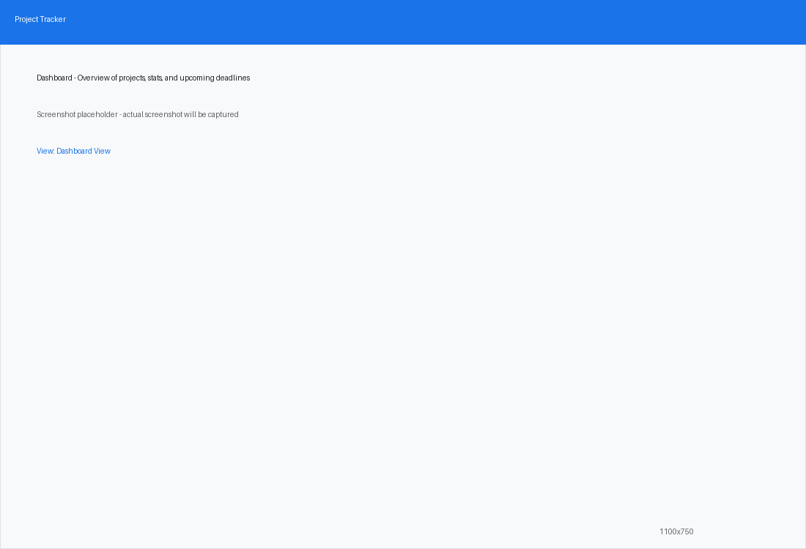
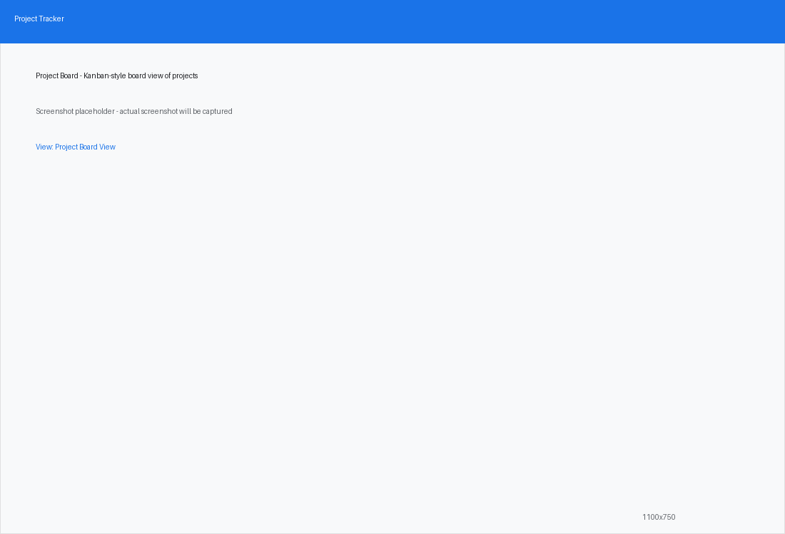
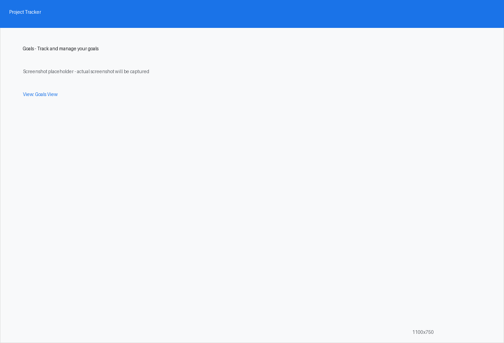

# Project Tracker Desktop

A clean, modern, offline-first Project Tracker desktop application built with **PySide6**, **QML**, and **SQLite**.

  

---

## Screenshots

| Dashboard | Projects |
|-----------|----------|
|  |  |

| Project Detail | Project Board |
|----------------|---------------|
|  |  |

| Goals | Audit Log |
|-------|-----------|
|  |  |

| Settings | Onboarding |
|----------|------------|
|  |  |

> **Note**: All screenshots are captured at the application's default window size of **1100x750 pixels**.

---

## Features

- **Dashboard Overview**: See high-level project metrics, active projects, and upcoming close deadlines in one place.
- **Project Management**: Create, edit, pause, complete, or delete projects with client details, email, and description.
- **Task & Step Tracking**: Add granular steps under projects with deadlines and interactive completion checkboxes.
- **Project Deliverables**: Define and track client deliverables with independent deadlines.
- **Resource Management**: Attach web links, document files, local folder paths, or quick notes directly to projects.
- **Search & Filtering**: Real-time project search by title/client and filtering by status (`Active`, `Paused`, `Completed`).
- **SQLite Database Storage**: Efficient local database storage (`project_tracker.db`) with automatic schema initialization.
- **Modular Architecture**: Clean separation between database queries (`db/`), PySide6 backend controller (`models/`), and QML UI component views (`qml/`).

---

## Project Structure

```text
.
 main.py                    # Application entry point
 requirements.txt           # Python dependencies
 README.md                  # Project documentation
 CHANGELOG.md               # Version history and changes
 CONTRIBUTING.md            # Guidelines for contributing & conventional commits
 qtquickcontrols2.conf      # Qt Quick Controls 2 configuration
 db/
    database.py            # SQLite database schema and CRUD operations
 models/
    project_controller.py  # PySide6 controller (Signals, Slots & Properties for QML)
 qml/
    main.qml               # Main window layout and sidebar navigation
    Style.qml              # Global style singleton
    style/                 # Custom Qt Quick Controls 2 templates
       Button.qml
       CheckBox.qml
       ComboBox.qml
       Slider.qml
       TextField.qml
       qmldir
    components/            # Reusable QML components
       CustomButton.qml
       CustomTextField.qml
       DeliverableItem.qml
       ProjectCard.qml
       ProjectDialog.qml
       ResourceItem.qml
       StatCard.qml
       StatusBadge.qml
       StepItem.qml
       common/              # Common reusable components
           Card.qml
           EmptyState.qml
           LoadingIndicator.qml
           Tooltip.qml
    views/                 # View screens
        DashboardView.qml
        ProjectsView.qml
        ProjectBoardView.qml
        GoalsView.qml
        AuditLogView.qml
        SettingsView.qml
        OnboardingView.qml
 tests/
     test_project_tracker.py # Unit tests for DB and Controller
```

---

## Installation

1. **Clone the repository**:
   ```bash
   git clone https://github.com/your-username/project-tracker.git
   cd project-tracker
   ```

2. **Create and activate a virtual environment** (optional but recommended):
   ```bash
   python -m venv .venv
   source .venv/bin/activate  # On Windows: .venv\Scripts\activate
   ```

3. **Install dependencies**:
   ```bash
   pip install -r requirements.txt
   ```

---

## Running the Application

Launch the desktop application using `main.py`:

```bash
python main.py
```

---

## Running Tests

Run the unit test suite using `pytest`:

```bash
PYTHONPATH=. pytest tests/
```

---

## Contributing

We welcome contributions! Please refer to [CONTRIBUTING.md](CONTRIBUTING.md) for details on commit message specifications ([Conventional Commits](https://www.conventionalcommits.org/)) and Pull Request guidelines. For version history, see [CHANGELOG.md](CHANGELOG.md).

---

## License

This project is licensed under the MIT License.
